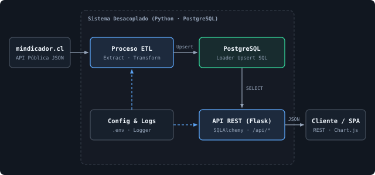

# Indicadores Económicos de Chile — Pipeline ETL en Python y API REST

[](https://www.python.org/)
[](https://www.postgresql.org/)
[](https://flask.palletsprojects.com/)

> Pipeline **ETL idempotente** en Python que extrae indicadores económicos de Chile desde `mindicador.cl`, normaliza y carga series históricas con lógica **Upsert** en **PostgreSQL**, y expone los datos mediante una **API REST** desacoplada en Flask.

---

## Contexto y Problema

Consultar APIs públicas de indicadores financieros (UF, Dólar, Euro, IPC) en cada solicitud de usuario genera dependencia de disponibilidad externa, latencia variable y ausencia de histórico local consultable.

Este proyecto separa la **ingesta de datos** (`etl_job.py`) del **servicio de consulta** (`run.py`), usando PostgreSQL como fuente única de verdad y garantizando recargas limpias sin duplicados.

---

## Arquitectura del Sistema

Dos procesos desacoplados que se comunican únicamente a través de PostgreSQL:



---

## Decisiones Técnicas

- **Desacoplamiento ETL vs API:** el job de ingesta (`backend/etl_job.py`) corre de forma independiente al servidor REST (`backend/run.py`), evitando que la carga histórica bloquee las consultas de lectura.
- **Carga incremental idempotente (Upsert):** [loader.py](backend/app/services/loader.py) inserta registros nuevos, actualiza cambios y omite duplicados, permitiendo re-ejecutar el ETL de forma segura ante fallos.
- **Arquitectura modular por capas:** patrón Factory (`create_app`) y separación estricta en `extractor.py`, `transformer.py` y `loader.py` junto a modelos SQLAlchemy.
- **Evolución prevista a AWS:** reemplazar el cron local por **EventBridge + AWS Lambda** para `etl_job.py`, mover PostgreSQL a **Amazon RDS** en subred privada y exponer la API mediante **API Gateway + Lambda / App Runner**.

---

## Seguridad y Configuración

- **Credenciales fuera del repositorio:** configuración gestionada mediante variables de entorno con plantilla en [backend/.env.example](backend/.env.example) y `.env` excluido en `.gitignore`.
- **Consultas parametrizadas:** interacción con PostgreSQL a través de SQLAlchemy ORM para prevenir inyección SQL.
- **Hardening para producción:** servir detrás de Gunicorn + reverse proxy HTTPS, restringir CORS al dominio cliente y migrar secretos a **AWS Secrets Manager** o **SSM Parameter Store**.

---

## Estructura del Repositorio

```text
Indicadores_Economicos/
├── backend/
│   ├── app/
│   │   ├── api/routes.py          # Endpoints REST (/api/indicators, histórico ?days=)
│   │   ├── models/indicator.py    # Modelos SQLAlchemy (Indicator, IndicatorValue)
│   │   ├── services/
│   │   │   ├── extractor.py       # Extracción desde mindicador.cl
│   │   │   ├── transformer.py     # Limpieza y normalización de series
│   │   │   └── loader.py          # Carga Upsert en PostgreSQL
│   │   ├── utils/logger.py        # Logging centralizado
│   │   └── __init__.py            # Application Factory y conexión DB
│   ├── etl_job.py                 # Punto de entrada del pipeline ETL
│   ├── run.py                     # Servidor API REST Flask
│   ├── requirements.txt           # Dependencias Python
│   └── .env.example               # Plantilla de variables de entorno
├── database/
│   └── __init__.sql               # Esquema inicial y catálogo de indicadores
├── docs/
│   └── architecture.svg           # Diagrama de arquitectura ETL y API
├── frontend/                      # Panel SPA complementario (HTML, CSS, Chart.js)
└── README.md
```

---

## Instalación y Ejecución

```bash
# 1. Clonar repositorio
git clone https://github.com/VitoNez5198/Indicadores_Economicos.git
cd Indicadores_Economicos

# 2. Crear base de datos e inicializar esquema en PostgreSQL
psql -U postgres -c "CREATE DATABASE indicadores_db;"
psql -U postgres -d indicadores_db -f database/__init__.sql

# 3. Configurar entorno Python y variables
cd backend
python -m venv venv
venv\Scripts\activate
pip install -r requirements.txt
copy .env.example .env

# 4. Ejecutar el pipeline ETL y levantar la API
python etl_job.py
python run.py
```

---

## Autor

**Víctor Martínez** — Junior Cloud Engineer | AWS, FinOps & Applied AI  
AWS Certified Cloud Practitioner • AWS Cloud re/Start • En preparación para SAA-C03

- **Portafolio:** [vitonez5198.github.io/Portfolio-VM](https://vitonez5198.github.io/Portfolio-VM/)
- **LinkedIn:** [victor-ms-dev](https://www.linkedin.com/in/victor-ms-dev/)
- **GitHub:** [@VitoNez5198](https://github.com/VitoNez5198)
